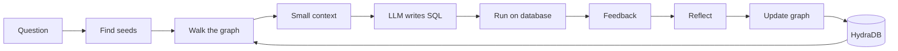

# Lore: the semantic layer that writes itself

> Working name. Rename it freely.
> Written 15 Nov 2026, about 3 PM IST. Submission cutoff: **16 Nov 2026, 9:00 AM IST**.
> This file explains what we are building and why. The step-by-step build instructions are in `spec-plan.md`.

## 1. Lore in one paragraph

Every data team has unwritten rules. "Status 2, 3 and 4 count as revenue." "School-level rows are `rtype = 'S'`." "Join orders to customers through accounts." Text-to-SQL agents fail without these rules, and today people write them down by hand in a semantic layer. Lore learns them instead. Each time the agent answers a question, Lore looks at what happened: did the SQL run, was it right, and if not, what did the analyst change. It turns that into small facts in a versioned graph stored in HydraDB. For the next question it walks the graph and gives the agent only the rules, joins and examples that question needs. The more it is used, the more accurate it gets.

## 2. The hackathon

| Item | Detail |
|---|---|
| Event | HydraDB Hackathon, https://luma.com/bqwllms4 |
| One rule | Build on the open-source HydraDB engine (`github.com/hydra-db/hydradb`), run by us, as the graph database. Not the hosted platform. |
| Our track | Track 1, the self-improving graph |
| Track 1 brief | "A graph search system that learns from its own answers to improve what it ingests and how it queries. Sharper the more it's used." Fair game: path compression, edge reweighting, gap-driven ingestion, entity split/merge. The bar: an accuracy curve rising over iterations. |
| Judging | Two equal halves: technical implementation and go-to-market |
| Technical half | Right metrics (not a vanity number). A clear baseline and real continual-learning improvement over it. The graph must do real work: would this fall apart on a plain store? Also: real graph traversal, holds up under load. |
| Go-to-market half | Post about the build on X, LinkedIn and other socials and tag HydraDB. Show who wants it and that it can be pitched as a product people pay for. |
| Submission | 1. A hosted app the judges can use (live link). 2. An open-source GitHub repo. 3. A Loom walking through what was built and how it works. |
| Prizes | Per track: winner 300 USD, runner-up 150 USD |
| Cutoff | 9:00 AM IST, 16 Nov 2026. Hard deadline. |

How each judging point is answered:

| What judges ask | What we show |
|---|---|
| Right metric | Execution accuracy on held-out questions: the SQL is run on the real database and its result is compared with the reference result. No LLM judge. |
| Baseline and continual learning | A floor (no learning), a ceiling (hand-written hints), and a vector-memory baseline that gets the same feedback. A curve of held-out accuracy against questions seen. |
| Graph does real work | An ablation that keeps the same learned facts but retrieves them from a flat store. Rules attached to a column are found through the column even when the question uses different words. Join paths come from HydraDB's native path procedure. |
| Holds up under load | A concurrency test of the grounding step against HydraDB, with p50, p95, p99 and throughput. |
| Who wants it | Data teams and anyone shipping a data agent. See section 10. |

## 3. Why this idea

- **The cost of missing rules is measured.** BIRD, the standard text-to-SQL benchmark, gives each question an optional expert hint. A secondary source reports GPT-4 at 54.89% with the hints and 34.88% without ([link](https://beancount.io/bean-labs/research-logs/2026/06/06/bird-benchmark-text-to-sql-real-database-gap)). We do not rely on that number. We measure our own floor and ceiling with our own model and report those.
- **A graph helps here, and that is published.** data.world found GPT-4 answering enterprise SQL questions went from 16.7% to 54.2% when a knowledge graph of the database was used ([paper](https://arxiv.org/abs/2311.07509), [follow-up](https://arxiv.org/html/2405.11706v1)).
- **Learning from corrections works, and that is published too.** A 2025 paper shows memory built from human feedback raises accuracy on BIRD over time ([arXiv 2511.10674](https://arxiv.org/abs/2511.10674)). It does not use a graph and is not a product.
- **It fits what SelfGraph is heading toward.** SelfGraph already has ontology features (terms, synonyms, definitions, schema drafts from table metadata). Its docs list text-to-SQL as planned and not built ([tiers doc](https://github.com/hydra-db/selfgraph/blob/main/docs/tiers.md)).
- **Other graph databases already market this use case.** FalkorDB has [QueryWeaver](https://www.falkordb.com/queryweaver-text-to-sql/) and Neo4j has a [semantic layer post](https://neo4j.com/blog/agentic-ai/how-a-neo4j-semantic-layer-makes-your-text-to-sql-agent-smarter-and-cheaper/). HydraDB has no equivalent yet.
- **There is room to improve.** Published scores on the 2026 Mini-Dev set for small, fast models are 51 to 70% (table in section 8).
- **It is unlikely to be duplicated in this hackathon.** Most Track 1 entries will be question answering over documents.

## 4. How it works

1. **Find seeds.** The words of the question are matched against names and synonyms in the graph (terms, columns, tables, past questions).
2. **Walk the graph.** From the seeds Lore follows edges to rules, to the columns those rules are about, to other rules on the same columns, to joins between the tables involved, and to past verified queries that used the same columns.
3. **Small context.** Only what the walk reached goes to the model, ranked by how often each rule has been right.
4. **Run.** The SQL runs read-only on the real database.
5. **Feedback.** The result, a thumbs up or down, and the corrected SQL when the analyst gives one.
6. **Reflect and update.** Right answers strengthen the edges that were used. Wrong answers weaken misleading edges, trigger profiling of the columns that were misunderstood, and are turned into new rules.

## 5. The graph

Everything is stored in HydraDB through the SelfGraph SDK. One namespace per database.

| Node | What it is |
|---|---|
| Table, Column | The database schema, with descriptions and sampled values |
| Term | A business phrase, with synonyms |
| Example | A past question with its verified SQL |

| Edge | From, to | Carries |
|---|---|---|
| HAS_COLUMN | Table to Column | |
| JOINS | Column to Column | Wins and losses, whether the schema declared it |
| MEANS | Term to Column or Table | The SQL fragment the phrase stands for, a note, wins and losses |
| TOUCHES | Example to Column | |
| JOIN_PATH | Table to Table | A proven multi-table join as one edge |

Every answered question is also saved as a SelfGraph decision trace whose steps are the edges it relied on. That is what lets feedback credit or blame exact edges, and it gives an audit trail.

## 6. How it learns

| Mechanism | Track 1 term | What it does | Priority |
|---|---|---|---|
| Rule learning | learns from its own answers | A wrong answer plus the corrected SQL becomes up to three reusable rules (Term, MEANS, Column) | P0 |
| Edge reweighting | edge reweighting | Edges used in a right answer gain a win. Rules that pointed at columns the correct query never used gain a loss. Unreliable rules stop being shown. | P0 |
| Targeted profiling | gap-driven ingestion | After a wrong answer, Lore samples the real values of only the columns it misunderstood and stores them on the column | P0 |
| Examples by graph overlap | improves how it queries | Past queries are picked because they touch the same columns, not because the wording is similar | P0 |
| Path compression | path compression | A multi-table join that keeps winning becomes one JOIN_PATH edge and one line of context | P1 |
| Synonym merge | entity merge | Terms that mean the same thing merge into one. SelfGraph records the merge and can undo it. | P1 |
| Certification | | An analyst can certify a rule. Certified rules rank first and are never hidden. | P1 |
| Term split | entity split | A term that keeps failing in two contexts splits in two | P2 |
| Time travel | | Replay what the graph knew when a past answer was given (`known_at`) | P2 |

P0 is required. P1 is built if P0 is done and measured. P2 is a stretch. Reported accuracy covers only what was in the benchmarked build, and the README says which mechanisms those were.

## 7. Why a graph, and who does what

**What would break on a plain store or a vector store:**

- A rule is attached to a column, not to a sentence. A new question that reaches that column by any route (a different phrase, a value, a join) gets the rule. Text similarity alone misses it.
- Joins between the tables a question needs are a path problem.
- Examples are chosen by shared structure (same columns), which wording-based search cannot see.
- Each fact has wins, losses, sources, versions and an optional certification. Corrections retire old facts without deleting history.

We do not just claim this. The benchmark includes a "same facts, flat retrieval" run so the graph's contribution is a number.

**SelfGraph** gives us: typed entities and relations, deterministic ids and idempotent inserts, versioned relations, evidence counts, entity merge and unmerge, certification, decision traces, lexical seeding, and `check_answerable`.

**HydraDB** is the engine underneath: it stores the graph, serves every read and write over Bolt, and (P1) runs join-path search natively with `algo.MSpaths`.

## 8. How we prove it

**Data**

- Held-out test set: BIRD Mini-Dev, 2026 release, SQLite version. 500 questions on 11 real databases, human-reviewed labels. 460 of the 500 are rated "challenging".
- Stream (what Lore learns from): the other questions in BIRD dev on the same 11 databases, capped per database. Any stream question that overlaps a test question (same text, same SQL, or very similar) is removed first, and the number removed is reported.

**Feedback Lore gets on stream questions only**

- Whether its SQL ran, and whether the result matched.
- The corrected SQL when it was wrong, as an analyst would give.
- Never BIRD's hint text. Never anything about a test question.

**Lines on the chart**

| System | What it is |
|---|---|
| Floor | The standard BIRD prompt with the full schema and no hints. No learning. |
| Ceiling | The same prompt with BIRD's hand-written hint for each question |
| Vector memory | Floor plus the three most similar past question and SQL pairs, found by embedding similarity. Sees the same stream. |
| Lore | Floor plus what the graph walk returns |
| Flat ablation | Lore's own learned facts, retrieved by embedding similarity instead of the graph |

**Numbers reported**

- Held-out execution accuracy at 0, 25, 50 and 100% of the stream.
- Lore minus floor and Lore minus vector memory at the end, with 95% confidence intervals (paired bootstrap).
- Share of the floor-to-ceiling gap closed.
- Prompt tokens per question for each system.
- Per-database table.
- Load test: p50, p95, p99 and requests per second for grounding at several concurrency levels.

**Published reference scores** for the same test set with hints, from the dataset's own page (SQLite column). These are the same setup as our ceiling.

| Model | Accuracy |
|---|---:|
| Claude Opus 5.5 | 90.0 |
| GPT-6.1 Sol | 88.0 |
| Claude Sonnet 5.5 | 86.6 |
| Qwen3.8-Flash-Next | 70.2 |
| DeepSeek-V4.1-Flash | 61.0 |
| Claude Haiku 5.5 | 59.6 |
| GPT-6 Luna | 54.0 |
| GLM-5.3 | 51.4 |

**Honesty rules**

- Every number in the README comes from a results file produced by the code in the repo.
- If the vector-memory baseline wins, the README says so.
- The metric is never changed to make a result look better.
- We state plainly that this run is one model, one seed (unless more were run), and that the stream uses the original BIRD dev labels, some of which are known to be wrong.

## 9. What already exists

| Project | What it does | How Lore differs |
|---|---|---|
| [Vanna](https://vanna.ai) | Text-to-SQL that retrieves stored question and SQL pairs | Flat retrieval of whole examples. Lore learns reusable rules and attaches them to the schema. Vanna-style memory is our baseline. |
| [QueryWeaver](https://www.falkordb.com/queryweaver-text-to-sql/) (FalkorDB) | Maps the schema as a graph for joins | By its own description it is a schema graph. Whether it learns from feedback was not confirmed (its page would not load during research). |
| [Neo4j semantic layer](https://neo4j.com/blog/agentic-ai/how-a-neo4j-semantic-layer-makes-your-text-to-sql-agent-smarter-and-cheaper/) | A graph semantic layer that people build | Built by hand. Lore builds it from usage. |
| dbt, Cube, Snowflake and Databricks semantic layers | Hand-written metric and join definitions | Months of manual work. Lore can export what it learned for review. |
| [arXiv 2511.10674](https://arxiv.org/abs/2511.10674) | Research: learning from human feedback on BIRD | No graph, no product |

Nothing here is entirely new. What a search on 15 Nov 2026 did not turn up is the combination: a learning loop, a versioned graph, and proof on a public benchmark.

The idea we rejected was a self-improving tool graph for MCP agents (Track 2). It matches that track's brief, but [AnythingMCP](https://anythingmcp.com/guides/knowledge-graph-mcp) and [skillgraph-mcp](https://github.com/jrodeiro5/skillgraph-mcp) already do it, and most Track 2 teams will build the same thing.

## 10. Who wants it

**Buyers**

- Data teams that answer the same ad-hoc questions every week.
- Companies shipping an "ask your data" feature or an internal data agent.
- Teams that started a semantic layer and found it takes months to write and goes stale.

**The pitch in 30 seconds**

> Your data agent gets questions wrong because the rules live in your analysts' heads. A semantic layer fixes that, if someone spends months writing it. Lore writes it for you. It watches every query the agent runs and every correction an analyst makes, keeps what it learns as a versioned graph, and gives the agent only the rules each question needs. On a public benchmark it went from [FILL: floor]% to [FILL: Lore]% after [FILL: N] questions, with no hand-written rules.

**How it could make money (a suggestion, not validated)**

- Open source, self-hosted: free.
- Hosted: priced per answered question or per seat.
- Enterprise: review and certification workflow, audit replay of what the agent knew, single sign-on.

**Cheap proof of demand to collect before the deadline**

- Two or three short quotes from people who work with data ("would you use this, and why").
- Replies and reposts on the launch posts.

## 11. Demo walkthrough (what a judge does on the live link)

1. Pick a database. Ask a suggested question. Lore answers, and the page shows the SQL, the result, and the part of the graph it walked.
2. The answer is wrong. Click thumbs down and type a one-line hint, or paste the right SQL.
3. Lore shows what it learned: a new rule appears in the graph.
4. Ask a second suggested question, worded differently, that needs the same rule. It is now right, and the page shows the rule being used.
5. Open the Graph tab: see every learned rule with its wins and losses, and certify one.
6. Open the Proof tab: the accuracy curve, the baselines, the ablation and the load numbers.

Each visitor gets a private cold-start copy, so they watch it learn from nothing. A "trained" copy shows the graph after the full benchmark stream.

## 12. Loom outline (3 to 4 minutes)

| Time | Show |
|---|---|
| 0:00 | The problem in one sentence, with one real wrong answer |
| 0:25 | Live: wrong answer, correction, the new rule in the graph, a different question now right |
| 1:30 | The graph: rules on columns, wins and losses, certification, the walk for one question |
| 2:10 | Proof: the curve between floor and ceiling, vector memory, the flat ablation, tokens |
| 2:50 | HydraDB and SelfGraph: what each does, native path search, the load test |
| 3:20 | Who pays, what is next, repo and live link |

## 13. Draft posts

Fill the blanks from `results/<run>/summary.json`. Do not post numbers that are not in that file. HydraDB's handle on X is `@hydra_db`.

**Post 1, send today (building in public)**

> Building for the @hydra_db hackathon tonight.
>
> Text-to-SQL agents fail on the rules nobody wrote down: "status 2, 3, 4 = revenue", "school-level means rtype = 'S'".
>
> Lore learns those rules from every query and every correction, keeps them in a graph on HydraDB + SelfGraph, and hands the agent only what each question needs.
>
> Results on a public benchmark by morning.

**Post 2, send with the submission (X)**

> Lore: the semantic layer that writes itself. Built on @hydra_db + SelfGraph.
>
> On BIRD Mini-Dev (500 held-out questions, real databases, results checked by execution):
> floor [FILL]% -> Lore [FILL]% after [FILL] questions of feedback
> vector memory with the same feedback: [FILL]%
> same facts without the graph: [FILL]%
>
> No hand-written rules. Live demo: [FILL link]. Code: [FILL link]. Walkthrough: [FILL Loom link].

**Post 3, LinkedIn**

> Most data agents are wrong for a boring reason: the rules live in people's heads.
>
> For the HydraDB hackathon I built Lore. It watches the queries a data agent runs and the corrections analysts make, and turns them into a versioned graph of business rules, joins and verified examples. For each new question it walks the graph and gives the agent only what that question needs.
>
> What I measured, on a public benchmark with real databases:
> - Held-out accuracy went from [FILL]% to [FILL]% as it saw [FILL] questions.
> - A vector store given the same feedback reached [FILL]%.
> - Taking the graph away but keeping the same learned facts gave [FILL]%.
>
> It is open source and built on HydraDB and SelfGraph. Demo, code and a short walkthrough are in the comments.
>
> If you run a data team, I would like to know: would you let something like this write your semantic layer?

## 14. Owner checklist

| When (IST) | Task |
|---|---|
| Now | Install Docker: `sudo apt-get update && sudo apt-get install -y docker.io docker-compose-v2 && sudo usermod -aG docker $USER` |
| Now | Create `/mnt/bigdrive/aditya/projects/hydradb/.env` from the template in `spec-plan.md` section 2 (MiniMax key, a random 32+ character HydraDB token) |
| Now | Send Post 1 |
| Today | Ask two or three data people for a one-line quote |
| By 2 AM | Create one Linux VM: Ubuntu 24.04, 4 GB RAM, 2 vCPU, billed hourly. A DigitalOcean droplet in Bangalore is the suggestion; any equivalent works. Check the price at signup. Give the builder its IP and SSH access. |
| When asked | Approve creating the public GitHub repo |
| 6:30 AM | Record the Loom using section 12 |
| 7:30 AM | Send Posts 2 and 3 with real numbers |
| By 8:30 AM | Submit the live link, the repo and the Loom |

## 15. Risks and honest limits

- **The gain may be small.** The model, the benchmark and the learning method all matter. We find out at milestone M2 (floor and ceiling) and M4 (first curve).
- **The vector-memory baseline may match Lore on accuracy.** Then the story is the flat ablation, the token cost and the audit trail, stated honestly.
- **SelfGraph is days old and HydraDB 0.4.0 is a day old.** Bugs are likely. The plan has fallbacks.
- **One model, one seed** unless time allows more.
- **Stream labels are noisy.** The stream uses original BIRD dev labels, which have known errors. Lore may learn a few wrong rules. That is realistic.
- **Hosting is not arranged yet.**

## 16. Sources

- Hackathon: https://luma.com/bqwllms4
- HydraDB engine: https://github.com/hydra-db/hydradb (read `USING-HYDRADB.md` and `AGENTS.md`)
- SelfGraph: https://github.com/hydra-db/selfgraph (read `SKILL.md` and `docs/`)
- HydraDB benchmark report: https://benchmarks.hydradb.com/hydradb
- Previous HydraDB hackathon: https://hackhydra.hydradb.com/
- BIRD: https://bird-bench.github.io/
- BIRD Mini-Dev 2026 data: https://huggingface.co/datasets/birdsql/bird_mini_dev
- MiniMax Anthropic-compatible API: https://platform.minimax.io/docs/api-reference/text-anthropic-api
