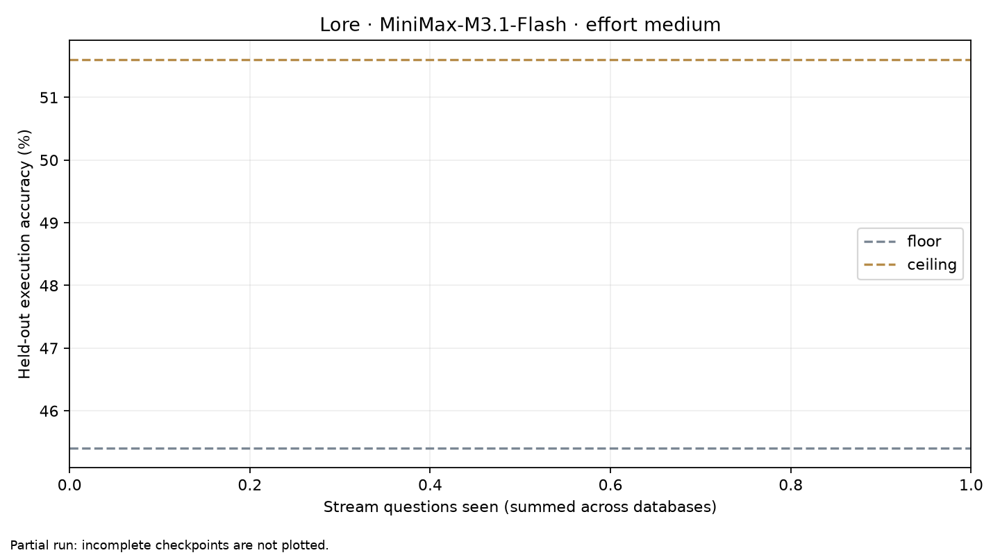

# Lore

A text-to-SQL semantic layer that learns reusable database knowledge from verified corrections, built on HydraDB and SelfGraph.

**Live demo:** [Lore](https://ishesatoshi-lore.hf.space), running on an existing
free CPU Basic [HF Space](https://huggingface.co/spaces/isHeSatoshi/lore).
A strict public-browser correction-and-reuse loop, scoped access-control checks,
keyboard/mobile checks and hosted seed restoration pass.
See the [public validation evidence](results/r4/hosting_public.json).
See [hosting status and release steps](deploy/hf/README.md).

## The problem

Database schemas say what columns exist. They rarely explain what “revenue”
means, which status codes count, or which join an analyst trusts. Prompting
the same model again does not retain that correction.

Lore stores those meanings as inspectable graph facts and retrieves a small
knowledge block for the next question. It does not fine-tune the model.

## Full benchmark results

**Lore scores 54.2%, versus 46.2% for schema-only prompting and 48.6% for
nearest-example vector memory.** Its advantage over flat retrieval of the
same learned facts is **inconclusive**, not a proven graph-specific accuracy gain.

Factory-only **`r4`**, **MiniMax M3.1 Flash, medium effort**, 500 held-out BIRD
Mini-Dev questions at every point, with an 864-question verified learning stream:

| System | Strict execution accuracy | 95% Wilson interval | Mean prompt tokens |
|---|---:|---:|---:|
| Floor, schema and question only | 46.2% (231/500) | 41.9–50.6% | 4,478 |
| Ceiling, supplied per-question evidence | 52.2% (261/500) | 47.8–56.5% | 4,509 |
| Lore, learned graph | **54.2% (271/500)** | 49.8–58.5% | 5,101 |
| Vector, three nearest verified examples | 48.6% (243/500) | 44.2–53.0% | 4,688 |
| Flat, retrieval from the same learned facts | 53.2% (266/500) | 48.8–57.5% | 5,382 |

Paired bootstrap differences, 10,000 resamples, seed 0:

| Comparison | Lore gain | 95% paired interval |
|---|---:|---:|
| Lore minus floor | +8.0 points | +3.0 to +13.0 |
| Lore minus vector | +5.6 points | +1.0 to +10.2 |
| Lore minus flat | +1.0 point | −3.8 to +5.6 |

Lore's checkpoints are **49.4% → 51.2% → 54.2%**. Vector's are
**44.8% → 49.0% → 48.6%**; learning is not guaranteed to help every question.
Lore loses to the floor on financial, debit-card and student-club questions.
Its final knowledge block averages 2,247 characters, versus flat's 3,337.

Sources: [complete results and metering](results/r4/summary.json),
[per-database results](results/r4/per_db.md), [graph counts](results/r4/counts.json)
and [frozen protocol](results/r4/learning_configuration.json).
All five systems and all six learned checkpoints are complete.
The run records **29.10M input tokens, 4.29M output tokens and 6,299 model calls**,
below the 80M recorded benchmark-input budget. SDK-internal/cancelled usage may
be unreported; demo discovery is separate from this benchmark total.
The [first 48 teaching trials](results/r4/demo_replay_round1.json) did not retain
per-trial metering before private cache deletion; later trials do. All failed
teaching outcomes are preserved and are not benchmark accuracy estimates.
The 6.0-point evidence headroom passes the baseline gate. “Ceiling” names that
reference condition, not a mathematical upper bound. The
[manual ceiling review](results/r4/ceiling_review.md) found no extraction or
execution fault in its ten reviewed mistakes.


<details>
<summary>Preserved raw-provider run and exploratory validation</summary>

The following table is historical **raw-provider `r2`**, not the SDK result.
That run remains paused on MiniMax's 2056 usage quota: the first two Lore
checkpoints cover 500/500 questions; the final checkpoint covers 258/500.
No raw-provider retry is running. SDK and raw-provider answers are never mixed.
The failed [`r3` preflight](results/r3/README.md) is excluded from comparisons.

| System | Strict execution accuracy | 95% Wilson interval | Evaluated |
|---|---:|---:|---:|
| Floor, schema and question only | 45.4% | 41.1–49.8% | 500/500 |
| Ceiling, supplied per-question evidence | 51.6% | 47.2–56.0% | 500/500 |
| Lore, learned graph | Pending | Pending | Not complete |
| Vector, verified-example retrieval | Pending | Pending | Not complete |
| Flat, retrieval from the same learned facts | Pending | Pending | Not complete |

Source: [`results/r2/summary.json`](results/r2/summary.json).
The baseline gap is 6.2 percentage points and passes the predeclared gate.
That gap measures the effect of supplied evidence, not a Lore improvement.
The [per-database report](results/r2/per_db.md) and
[manual ceiling review](results/r2/ceiling_review.md) preserve the current evidence.
Incomplete points are explicitly marked and are not plotted as completed scores.

An exploratory two-database validation (`s1`) scored 34/95 for floor and 45/95
for Lore. Its paired difference interval includes zero, and its rule-quality
audit failed. It is preserved in [`results/s1/`](results/s1/) with the
[audit findings](results/s1/rule_review.md), not presented as a final gain.
A second exploratory run (`s2`) scored 34/95 for floor and 50/95 for Lore, but
[its audit](results/s2/rule_review.md) still found overbroad meanings and aliases.
Those runs are not used to select the best reported accuracy. Final small-run
validation (`s3`) scored 34/95 for floor and 49/95 for Lore. All 87 MEANS
relations were inspected and both leak checks passed. The
[review](results/s3/rule_review.md) records final validator repairs and remaining
noisy meanings/aliases. These exploratory results are not a full-test gain.
The recorded `s3` score predates its final post-review validator guards and was
not rescored afterward.



</details>

## How it works

```text
Question → lexical graph grounding → bounded knowledge block → model → read-only SQL
                     ↑                                                   ↓
              reusable graph facts ← verified SQL and analyst correction
```

The graph model is small:

- `Table → HAS_COLUMN → Column` stores the real SQLite schema.
- `Term → MEANS → Column` stores a reusable SQL meaning, provenance and feedback.
- `Column → JOINS → Column` stores declared and observed joins.
- `Example → TOUCHES → Column` connects verified SQL to its structure.
- Column profiles record distinct counts, null counts and bounded example values.

Correct feedback strengthens relevant rules. Incorrect feedback can weaken
rules that pointed at the wrong columns. Certified rules are not silently
rewritten. Learning is isolated from frozen test evaluation.

## What the graph adds

The graph exposes rule provenance, revisions, certification and structural
connections, rather than only retrieving similar question text.
The same-facts flat ablation scores 53.2% against Lore's 54.2%; the paired
interval includes zero. This experiment does **not** establish an accuracy
advantage from graph structure over those flat facts.
Identical rendered facts share one retrieval slot, so a meaning attached to
multiple columns does not crowd other facts out of the flat comparison.

## HydraDB and SelfGraph

HydraDB persists the graph. SelfGraph supplies entities, relations, revisions,
certification, namespaced facts and lexical retrieval. Grounding expands those
facts and ranks rules using their feedback history.

Current grounding uses stored direct joins. Native multi-hop path search,
path compression and synonym merging are not implemented. The application
does not pretend these mechanisms are enabled.

## Benchmark protocol and limits

- Fixed model and effort: MiniMax M3.1 Flash, medium. `r4` uses the official
  Factory SDK with the exact `minimax-m3.1-flash` catalog ID.
- Each SDK completion starts a fresh session in an empty home and working
  directory. An explicit deny/allow intersection disables all tools; the
  transport verifies zero allowed tools before every inference request.
  Droid manages the output-token limit. This differs from `r2`'s raw API
  contract, so all matching comparisons are rerun rather than combined.
- Held-out BIRD Mini-Dev SQLite questions; published prompts are reproduced
  exactly. Floor removes only the supplied evidence, not the schema.
- Learning uses the public BIRD dev stream after same-database question/SQL
  overlap and token-Jaccard filtering. Split and seed are recorded in the report.
- Lore and vector learn sequentially within each database, then freeze at each
  checkpoint. Test questions and their evidence never become learned facts.
- Strict execution compares complete sets of row tuples. Output row order and
  duplicate multiplicity are ignored; column order and exact values matter.
  Execution failures are not treated as empty results.
- Model/network failures retry or stop the run rather than silently becoming
  wrong answers. SQL timeouts remain execution failures.
- Frozen learning sources and runtime adjustments are recorded in
  [`learning_configuration.json`](results/r4/learning_configuration.json).
- Wilson intervals describe accuracy; paired bootstrap intervals compare the
  same completed test questions. Partial runs are not evidence of a gain.

This is one model, one public benchmark and a simulated analyst-feedback
stream, not a claim of general production performance. Gold SQL and execution
timeouts can limit the benchmark. The interactive app caps displayed results;
the benchmark evaluates full results without that display cap.
Rule confidence is feedback-based, not semantic proof. A query can succeed
despite an irrelevant retrieved rule, and source labels can encode quirks.

## Load test

The [trained load report](results/r4/load.json) exercises all eleven completed
namespaces without an LLM or cross-request graph cache. One fresh process sends
1,000 requests per level, with 10, 50 or 100 offered clients.

| Clients | p50 | p95 | p99 | Requests/sec | Errors |
|---:|---:|---:|---:|---:|---:|
| 10 | 0.95 s | 3.92 s | 4.74 s | 6.84 | 0/1000 |
| 50 | 1.95 s | 24.13 s | 26.08 s | 6.96 | 0/1000 |
| 100 | 6.66 s | 41.23 s | 42.75 s | 6.79 | 0/1000 |

These are local 4-CPU observations, not hosted latency guarantees. One active
grounding request per namespace protects its four driver connections; all
admission waiting is included in latency. This passes the zero-error gate,
not a low-latency scaling claim. Graph size comes from the completed immutable
run's full audit, identified by hash in the load report, not a fresh recount.

The first [complete stress attempt](results/r4/load.failed1.json) had pool
timeouts. The live reader now anchors join reads at every column of reached
tables and queues whole requests rather than flooding the pool. Its full
blocks and traces match the original reader on [all 500 held-out inputs](results/r4/live_reader_validation.json).
All sixteen frozen benchmark/runtime source hashes remain unchanged.

[Teaching discovery](results/r4/demo_discovery.json) establishes three strict
fresh correction-and-transfer pairs per selected database, 12 passes across
161 retained trials. This is selected demonstration evidence, not a 12/12
future-success guarantee. No single-question fallback was needed.

## Run locally with the measured Factory transport

Requires Python 3.11+, Node 24, Docker with Compose, and a Factory API key.
Run these from the repository root. After command 2, edit the private `.env`:
set `HYDRA_TOKEN` to a fresh secret and add `FACTORY_API_KEY`. Never commit `.env`.
These startup commands are for a fresh environment, not an active benchmark host.

```sh
python3 -m venv .venv && .venv/bin/pip install -e '.[bench,dev,factory]'
cp .env.example .env
docker compose up -d hydradb && .venv/bin/python -m lore.bench.download
(cd web && npm ci && npm run build)
export PATH="$(.venv/bin/python -c 'from pathlib import Path; from deploy.hf.droid_runtime import provision_droid; print(provision_droid(Path.home()/".cache/lore-cli").parent)'):$PATH"
export LORE_LLM_TRANSPORT=factory LORE_LLM_MODEL=minimax-m3.1-flash
export LORE_LLM_EFFORT=medium LORE_LLM_MAX_TOKENS=0 LORE_RESULTS_RUN=r4
export LORE_STATE_DIR="$PWD/data/app-state"
LORE_LLM_CONCURRENCY=2 LORE_LLM_MIN_INTERVAL_S=2 .venv/bin/uvicorn lore.api:app --host 127.0.0.1 --port 8000 --no-access-log
```

Open `http://127.0.0.1:8000`. Without completed seeds and a measured demo
manifest, the app deliberately offers an untrained sandbox, not a claimed
trained demo. Benchmark downloads are separate from Git.

The sandbox accepts read-only queries. A correction is only a proposal until
the analyst confirms it. Execution checking does not prove semantic correctness:
the person confirming SQL is responsible for its meaning. Sandbox state is
separate from shared trained facts and all benchmark namespaces.

## Reproduce the Factory benchmark

Install the project with `.[bench,dev,factory]` and the reviewed, pinned
Droid CLI described in [the runtime instructions](deploy/hf/README.md).
Keep `FACTORY_API_KEY` in the ignored private `.env`. Use a fresh run ID;
`r4` is the recorded run and must not be overwritten.

```sh
export LORE_LLM_CONCURRENCY=6 LORE_LLM_MIN_INTERVAL_S=0.5
.venv/bin/python -m lore.bench.check_data --run reproduction
.venv/bin/python -m lore.bench.factory_runtime --run reproduction --systems floor,ceiling
.venv/bin/python -m lore.bench.review_baselines --run reproduction
.venv/bin/python -m lore.bench.factory_runtime --run reproduction --systems lore --stream-cap 80 --checkpoints 0.25,0.5,1.0
.venv/bin/python -m lore.bench.factory_runtime --run reproduction --systems vector --stream-cap 80 --checkpoints 0.25,0.5,1.0
.venv/bin/python -m lore.bench.factory_runtime --run reproduction --systems flat --from-run reproduction
.venv/bin/python -m lore.bench.report --run reproduction
.venv/bin/python -m lore.seeds export --run reproduction --out seeds/
.venv/bin/python -m lore.bench.load --run reproduction --concurrency 10,50,100 --requests 1000
```

The Factory entry point fixes the model and effort, captures source hashes,
uses a separate completion cache, and refuses historical raw/preflight run IDs.
The original runner still enforces the full 500-question floor/ceiling gate
before learning. A failed request stops rather than becoming a wrong answer.

To run the interactive app or teaching replays with this same protocol, set:

```sh
export LORE_LLM_TRANSPORT=factory LORE_LLM_MODEL=minimax-m3.1-flash
export LORE_LLM_EFFORT=medium LORE_LLM_MAX_TOKENS=0 LORE_RESULTS_RUN=r4
```

Here `max_tokens=0` explicitly means SDK-managed, not a zero-token generation.
The runtime entrypoint caps each namespace's client connection pool at four.
After two Bolt handshake interruptions, `r4` resumed with this scheduling-only
change, recorded in [runtime configuration](results/r4/runtime_configuration.json).
The [comparison check](results/r4/connection_pool_validation.json) preserves
identical original/capped grounding on its recorded real inputs. Earlier
answers remain intact; no prompt, query, learning rule or metric changed.
The API and trained-load entrypoint use the same connection cap.
For tests use `.venv/bin/pytest -q`; add `LORE_INTEGRATION=1` for real HydraDB.

### Historical raw-provider reproduction

Use a new run ID if changing the model, effort, split, database selection or
learning protocol. The paused raw-provider run is `r2`; do not mix it with
Factory `r4`, failed preflight `r3`, or maximum-effort `r1`.

```sh
export LORE_LLM_EFFORT=medium LORE_LLM_CONCURRENCY=2 LORE_LLM_MIN_INTERVAL_S=2
.venv/bin/python -m lore.bench.check_data --run r2
.venv/bin/python -m lore.bench.run --run r2 --systems floor,ceiling
.venv/bin/python -m lore.bench.review_baselines --run r2
```

First inspect the complete baseline gap and manual review. Do not bypass the
baseline gate. Then run and inspect the small learning validation before the
full systems:

```sh
.venv/bin/python -m lore.bench.run --run validation --baseline-run r2 --systems floor,lore --dbs financial,california_schools --stream-cap 30 --checkpoints 1.0
.venv/bin/python -m lore.bench.inspect_rules --run validation
export LORE_LLM_CONCURRENCY=4
.venv/bin/python -m lore.bench.run --run r2 --systems lore --stream-cap 80 --checkpoints 0.25,0.5,1.0
.venv/bin/python -m lore.bench.run --run r2 --systems vector --stream-cap 80 --checkpoints 0.25,0.5,1.0
.venv/bin/python -m lore.bench.run --run r2 --systems flat --from-run r2
.venv/bin/python -m lore.bench.report --run r2
.venv/bin/python -m lore.seeds export --run r2 --out seeds/
.venv/bin/python -m lore.bench.load --run r2 --concurrency 10,50,100 --requests 1000
```

Run `.venv/bin/pytest -q` for local tests. For real HydraDB integration checks,
run `LORE_INTEGRATION=1 .venv/bin/pytest -q`.
The latest [integration-enabled release check](results/smoke/release_tests.hosted.json)
passes all **171 tests**, with zero skips and all six runtime source hashes
unchanged during the run. Ruff and the typed frontend build also pass.
The [fresh-clone check](results/smoke/clean_clone.hosted.json) separately passed
new Python/npm installs, 165 nonintegration tests and the real local HTTP
entrypoint, reusing downloaded BIRD data and the existing Hydra without restart.
Use an unused validation run ID. The recorded `s1`–`s3` runs are historical
calibrations, not results to overwrite with the final code.

## Interactive validation and deployment limits

The sandbox UI, correction confirmation, rule certification, seed round-trip,
vector and flat implementations, paired reporting and deployment image exist.
Full accuracy comparisons and a real four-database seeded cold start are now
complete. All twelve teaching pairs and all 3,000 trained-load requests pass.
The [public browser trial](results/r4/hosting_browser.json) independently
re-executes SQL and confirms correction-to-transfer on toxicology. Its failed
school trial is retained. This is selected demo evidence, not a future-success
guarantee.

VM deployment instructions are in [`deploy/README.md`](deploy/README.md);
the approved free-hosting route is in [`deploy/hf/README.md`](deploy/hf/README.md).
The existing free CPU Space is running and the strict public-browser teaching
loop passes. All four trained public graph projections match their pre-rebuild
hashes, with 345 MEANS rules restored. The visitor sandbox reset, as expected.
Seven desktop/mobile/error accessibility audits report zero violations.
The chart's incomplete automated contrast check has a separate rendered-color
check; this is not full WCAG certification.
The [native proof](results/r4/hosting_cold.json) exercises HF's hostname and
HTTPS routing: 22.32 seconds fresh, 5.03 seconds on restart, zero model calls.
These local startup times are not hosted latency guarantees.
No CSP, Referrer-Policy, X-Content-Type-Options or X-Frame-Options response header
was observed. Scoped access-control checks are not a complete security audit.
Free hosting can sleep and lose visitor state; model quotas still apply.
New public GitHub repository creation is blocked by the integration's HTTP 403;
no existing private repository was made public.
The [submission handoff](SUBMISSION.md) tracks owner actions and outstanding gates.

## Data attribution

Benchmark questions, SQL and databases come from [BIRD](https://bird-bench.github.io/)
and the [BIRD Mini-Dev release](https://huggingface.co/datasets/birdsql/bird_mini_dev).
Source URLs and hashes are recorded in
[`results/data/sources.json`](results/data/sources.json).
BIRD data and derived benchmark/seed data retain **CC BY-SA 4.0** terms.
Downloaded databases are not included in this repository.
See [data attribution and modification notices](DATA_LICENSE.md).

## License

Lore code is [MIT licensed](LICENSE). Dataset rights and attribution are separate.
