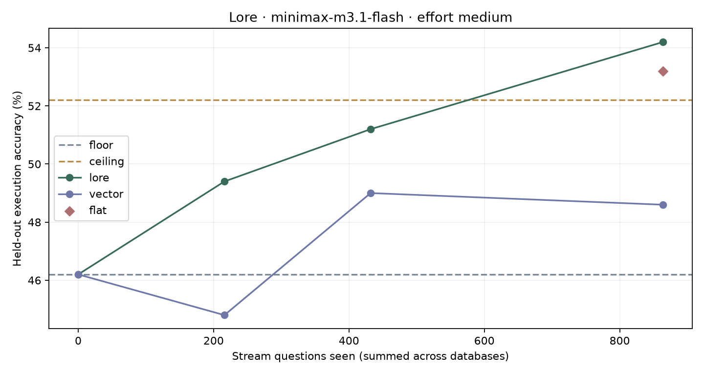

# Lore

### An agent can write valid SQL and still answer the wrong question. Lore helps it learn from the correction.

_Built for the [HydraDB Hackathon](https://luma.com/bqwllms4), Track 1: the self-improving graph._

[Try Lore](https://ishesatoshi-lore.hf.space) · [Full results](results/r4/summary.json) · [Every database](results/r4/per_db.md) · [For judges](SUBMISSION.md) · [Check the numbers](docs/REPRODUCE.md) · [Source](https://github.com/isHeSatoshi/lore)



## The problem

Ask a database agent for revenue and it can find a column with the right name. That does not tell it which orders count, whether refunds belong in the total, or which join the analyst actually trusts. The SQL can run, return a plausible number, and be wrong.

An analyst can explain the mistake. But if that explanation stays in one conversation, the next question starts from the same schema and makes the same mistake. Putting more examples in a prompt helps only when the right example happens to be there.

We built Lore to keep the useful part of a correction. It turns verified SQL and analyst feedback into small, inspectable meanings attached to database columns. The next question retrieves those meanings, not the entire conversation. The model stays the same; the knowledge around it changes.

The question we tested was simple: does accumulating that knowledge make the same model better at answering new questions?

## The result

We ran **MiniMax M3.1 Flash at medium effort through the Factory SDK** on 500 held-out BIRD Mini-Dev questions. Lore learned from a separate stream of 864 verified questions across eleven databases. We evaluated the same held-out questions after a quarter, half, and all of that stream, without learning from their answers or supplied evidence.

| What the model receives | Correct out of 500, higher is better | Mean prompt tokens |
|---|---:|---:|
| Schema and question only | 231 (46.2%) | 4,478 |
| Schema, question and supplied evidence | 261 (52.2%) | 4,509 |
| Lore's learned graph | **271 (54.2%)** | 5,101 |
| Three nearest verified examples | 243 (48.6%) | 4,688 |
| Flat retrieval of the same learned facts | 266 (53.2%) | 5,382 |

Lore answered **40 more questions correctly than schema-only prompting**, an eight-percentage-point gain. Its accuracy rose **49.4% → 51.2% → 54.2%** as it saw more verified examples. Vector memory finished at 48.6%.

The paired 95% interval for Lore's gain is **+3.0 to +13.0 points** against schema alone and **+1.0 to +10.2** against vector examples. These compare answers to the same questions, using 10,000 bootstrap resamples.

The important control is the last row. Flat retrieval gets the same learned facts, without Lore's structural grounding. Lore's one-point lead has an interval of **−3.8 to +5.6 points**. That comparison is inconclusive. We have evidence that the learned knowledge helps, not that graph structure itself beats flat retrieval on accuracy.

Lore's final knowledge block averages 2,247 characters, against flat retrieval's 3,337. The [full report](results/r4/summary.json) includes uncertainty, prompt usage and every checkpoint; the [per-database report](results/r4/per_db.md) shows where the gains disappear.

## The loop: ask → correct → reuse

1. **Ask with context.** Lore grounds a question in the schema and stored meanings, builds a bounded knowledge block, and asks the model for read-only SQL. You can inspect the SQL, result and knowledge it used.
2. **Review the correction.** An analyst adds a hint and inspects the proposed SQL. A proposal does not become a lesson until the analyst explicitly confirms it.
3. **Keep the lesson.** Lore extracts reusable meanings, links them to columns, and stores their provenance and feedback. A different question can retrieve those meanings without being taught separately.

We tested this with fresh correction-and-transfer pairs: the first question was wrong, its correction was confirmed, and a different, previously wrong question became correct using a new rule. The second question was never taught.

Discovery found three such pairs in each of four selected databases, **12 passes across 161 retained trials**. Those are selected demonstrations, not a promise that the next twelve attempts will pass. A separate [public-browser trial](results/r4/hosting_browser.json) completed the loop on toxicology and retained its failed school trial too.

## Read it with care

**The graph comparison is unresolved.** The same-facts control is close to Lore. Provenance, revisions and inspectable connections are concrete graph features; a graph-specific accuracy advantage is not established here.

**More memory does not always help.** Lore loses to schema-only prompting on financial, debit-card and student-club questions. Vector accuracy also falls between its second and final checkpoints. A rising aggregate curve does not mean every database or question improves.

**This is one experiment, not a production guarantee.** We used one model, one seed, public benchmark data and a simulated analyst-feedback stream. Question/SQL overlap and token-similarity filters separate the learning stream from the test set. They do not make the benchmark private or establish generalization to your company.

**“Correct” means execution agreement.** We run the full SQL against SQLite and compare complete sets of row tuples with the reference. Row order and duplicate multiplicity are ignored; column order and exact values matter. Errors are not empty answers. A match is not a proof that the reference captures every intended business meaning.

**The evidence baseline is not an upper bound.** The report calls supplied per-question evidence the “ceiling.” That names a comparison condition, not a mathematical limit. Lore can score above it.

**Usage has a boundary.** The benchmark records 29.10M input tokens, 4.29M output tokens and 6,299 model calls. SDK-internal or cancelled usage may be unreported, and teaching discovery is separate. The first 48 teaching trials did not retain per-trial metering; their outcomes, including failures, remain available.

Every control, interval, historical run and reproduction command is in the [measurement and reproduction notes](docs/REPRODUCE.md).

## How it works

1. **Describe the database.** Import the real SQLite schema and bounded column profiles. Tables connect to columns through `HAS_COLUMN`; declared and observed joins connect columns through `JOINS`.
2. **Ground the question.** Start with lexical matches, expand the stored schema connections, and retrieve meanings and examples attached to reached columns. Rank them using their feedback history and fit them into a bounded knowledge block.
3. **Ask and check.** Generate read-only SQL. In the benchmark, execute it and compare with the reference result. In the app, show the proposal to the person responsible for confirming its meaning.
4. **Learn and retain the source.** Store `Term → MEANS → Column` rules and `Example → TOUCHES → Column` links. Feedback can strengthen useful rules or weaken misleading ones. Certified rules are not silently rewritten.

HydraDB persists the graph. SelfGraph supplies entities, relations, revisions, certification, namespaces and lexical retrieval. Lore supplies the SQL grounding, learning loop and evaluation.

The current reader uses stored direct joins. Native multi-hop path search, path compression and synonym merging are **not implemented**. The [original proposal](spec-plan.md) describes ideas beyond the delivered system; it is not a feature checklist.

### What happens under load

We sent 1,000 trained grounding requests at each of 10, 50 and 100 offered clients, across all eleven namespaces. There were no model calls and no cross-request graph cache.

| Offered clients | Errors | p99 latency, including queueing | Requests per second |
|---:|---:|---:|---:|
| 10 | 0/1,000 | 4.74 s | 6.84 |
| 50 | 0/1,000 | 26.08 s | 6.96 |
| 100 | 0/1,000 | 42.75 s | 6.79 |

This passes the zero-error gate, not a low-latency scaling claim. One grounding request at a time per namespace protects its four driver connections. These are local four-CPU measurements, not hosted-app latency guarantees.

The [first stress attempt](results/r4/load.failed1.json) had connection-pool timeouts. The repaired live reader queues whole requests and matches the original reader's full blocks and traces on [all 500 held-out inputs](results/r4/live_reader_validation.json). The frozen benchmark sources were not changed. The [load report](results/r4/load.json) retains the full measurements and their scope.

## Check it yourself

The results above are committed files. Reading them does not require model access. Rerunning the benchmark does require the data, HydraDB, a Factory API key and model quota.

For the local test checks, start from a fresh clone:

```sh
git clone https://github.com/isHeSatoshi/lore.git
cd lore
python3 -m venv .venv
.venv/bin/pip install -e '.[bench,dev,factory]'
.venv/bin/python -m lore.bench.download
.venv/bin/pytest -q -m 'not integration'
.venv/bin/ruff check lore tests deploy/hf
```

Use Python 3.11 or newer. The download fetches BIRD data, which the leakage test needs even when integration tests are excluded. These tests do not need model calls or a running HydraDB.

The [fresh-install check](results/smoke/clean_clone.hosted.json) passed 165 nonintegration tests, fresh Python/npm installs and the real local HTTP entrypoint, reusing downloaded BIRD data and an existing HydraDB. The separate [integration-enabled release check](results/smoke/release_tests.hosted.json) passed all 171 tests with zero skips. Ruff and the typed frontend build also passed.

For the full experiment, follow [Reproduce the Factory benchmark](docs/REPRODUCE.md#reproduce-the-factory-benchmark). Use a fresh run ID. Do not overwrite the recorded runs or restart an active benchmark database.

## Try it on your own machine

The easiest starting point is the [hosted demo](https://ishesatoshi-lore.hf.space). It has four measured databases and 345 restored rules in the trained view. The sandbox keeps your corrections separate from those shared facts.

Start a fresh sandbox, ask a suggested question, inspect the SQL, then use a correction only if the answer is wrong. Confirm the revised SQL only after checking it. Ask a different question and inspect which rules it retrieved. A successful query by itself does not show that a correction transferred.

For a local app, follow [Run locally with the measured Factory transport](docs/REPRODUCE.md#run-locally-with-the-measured-factory-transport). You will need Python 3.11+, Node 24, Docker Compose and a Factory API key. The official SDK also needs the pinned Droid CLI described in the [runtime instructions](deploy/hf/README.md).

Without completed seeds and a measured demo manifest, a local installation deliberately offers an untrained sandbox rather than claiming to reproduce the trained demo. The [free-hosting guide](deploy/hf/README.md) covers packaging and deployment checks.

## What is in this repository

| Path | What it is |
|---|---|
| [`lore/`](lore/) | Graph grounding, learning, read-only SQL execution and the API |
| [`lore/bench/`](lore/bench/) | Fixed-model benchmark, controls, reports and load checks |
| [`web/`](web/) | Ask, graph and proof views |
| [`results/r4/`](results/r4/) | Completed Factory results, audits and hosted validation |
| [`seeds/`](seeds/) | Exported graph knowledge, separate from downloaded databases |
| [`tests/`](tests/) | Unit, leakage, API, seed and deployment checks |
| [`docs/REPRODUCE.md`](docs/REPRODUCE.md) | Full protocol, commands, uncertainty and historical results |
| [`deploy/hf/`](deploy/hf/) | Free CPU hosting, native runtime and release checks |
| [`SUBMISSION.md`](SUBMISSION.md) | Judge handoff and outstanding owner actions |
| [`LOOM_SCRIPT.md`](LOOM_SCRIPT.md) | Under-two-minute narration and recording cues |

## Where this came from

Lore began with the idea that a correction should become a reusable database meaning, not another example buried in a prompt. The [project notes](ABOUT_PROJECT.md) explain the motivation and buyer hypothesis; the [proposal](spec-plan.md) records what we intended to test.

The early small runs exposed noisy and overbroad rules. Their audits remain in [`results/s1/`](results/s1/), [`results/s2/`](results/s2/) and [`results/s3/`](results/s3/). A raw-provider run stopped on quota, and a failed SDK preflight was excluded. The completed results here come only from Factory run `r4`; answers from different transports are not combined. The [reproduction notes](docs/REPRODUCE.md#preserved-raw-provider-run-and-exploratory-validation) retain that history.

## Limits

- Execution checks and feedback weights do not prove a rule's meaning. The person confirming a correction remains responsible for it.
- The free hosted app can sleep, visitor state can disappear, and model quotas still apply.
- Scoped access-control and accessibility checks are not a complete security audit or WCAG certification. See the [public validation report](results/r4/hosting_public.json) for the actual checks and remaining limits.
- Teams building internal data agents are the initial buyer hypothesis. Demand and willingness to pay have not been validated.

Lore code is [MIT licensed](LICENSE). Questions, SQL and databases come from [BIRD](https://bird-bench.github.io/) and [BIRD Mini-Dev](https://huggingface.co/datasets/birdsql/bird_mini_dev). BIRD data and derived benchmark/seed data retain **CC BY-SA 4.0** terms; downloaded databases are not in Git. See [data attribution and modification notices](DATA_LICENSE.md). HydraDB and the official Droid runtime retain their own license and notice requirements, described in the [hosting guide](deploy/hf/README.md).
